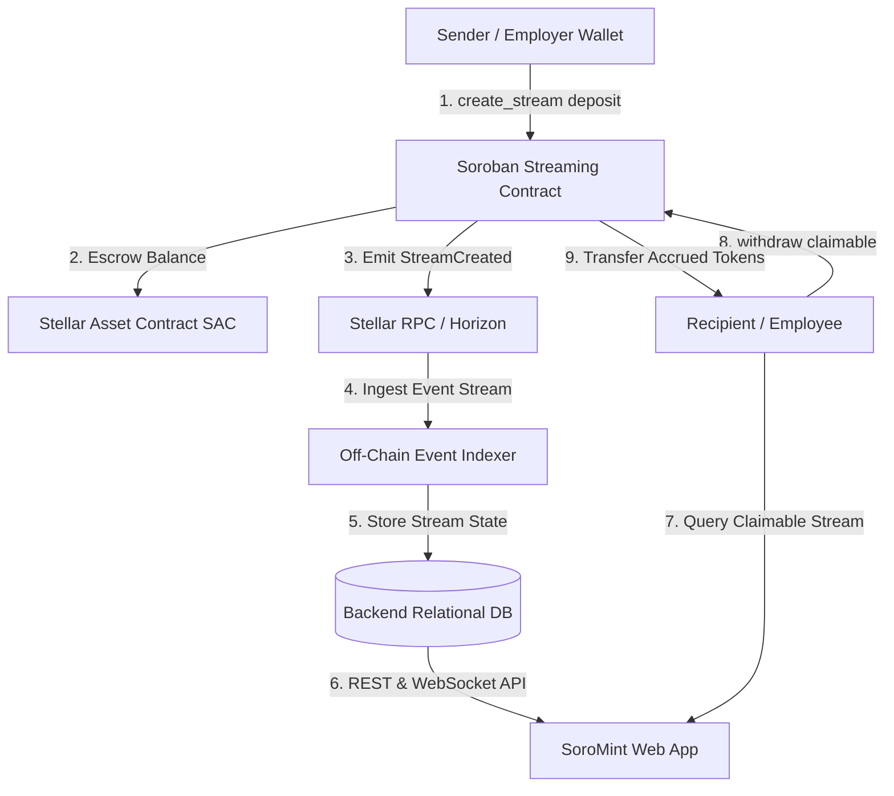
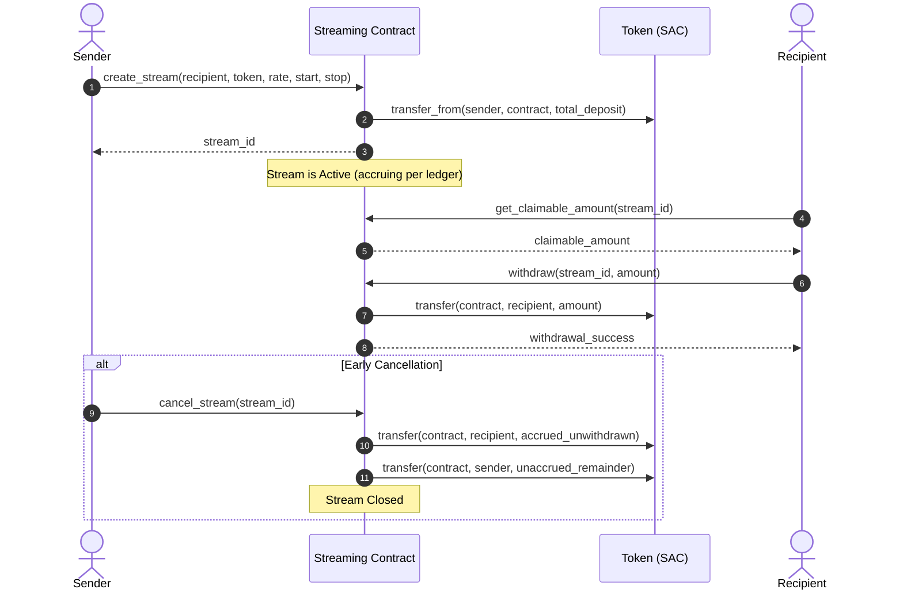

# Streaming Payments Architecture

**Status:** Living Architectural Specification  
**Document Location:** `docs/architecture/streaming-architecture.md`  
**Related Issue:** #719  
**Target:** SoroMint Protocol Contributors & Integrators  

---

## 1. Executive Summary

The SoroMint Streaming Payments system enables continuous, per-ledger token distribution between senders and recipients. Designed for automated real-time payroll, continuous subscriptions, and milestone-based vesting, the system allows senders to lock funds into an escrowed smart contract which recipients can drawdown dynamically as ledgers close on the Stellar network.

---

## 2. High-Level System Architecture

The streaming payments ecosystem connects on-chain Soroban smart contracts, off-chain event indexers, and client interfaces.



---

## 3. On-Chain Smart Contract Design

The Soroban streaming contract (`contracts/streaming/src/lib.rs`) manages stream state, authorization, and balance escrow without needing off-chain keepers for execution.

### Key Data Structures

```rust
pub struct Stream {
    pub sender: Address,
    pub recipient: Address,
    pub token: Address,
    pub rate_per_ledger: i128,
    pub start_ledger: u32,
    pub stop_ledger: u32,
    pub withdrawn: i128,
    pub operator: Option<Address>,
}
```

- **`rate_per_ledger`**: Quantity of token atoms accrued for each closed ledger.
- **`start_ledger` & `stop_ledger`**: The explicit ledger sequence boundary during which stream emissions occur.
- **`withdrawn`**: Cumulative volume of tokens drawn by the recipient to date.

---

## 4. Accrual & Claimable Math

Accrual calculations are completely deterministic and rely on the current ledger sequence `current_ledger = env.ledger().sequence()`:

### Continuous Linear Stream Calculation

1. **Elapsed Ledgers ($E$):**
   $$\text{effective\_ledger} = \min(\text{current\_ledger}, \text{stop\_ledger})$$
   $$E = \max(0, \text{effective\_ledger} - \text{start\_ledger})$$

2. **Total Accrued Amount ($A$):**
   $$A = E \times \text{rate\_per\_ledger}$$

3. **Current Claimable Balance ($C$):**
   $$C = A - \text{withdrawn}$$

Recipients may invoke `withdraw(stream_id, amount)` at any point while $0 < \text{amount} \le C$.

---

## 5. Stream Lifecycle & State Transitions



---

## 6. Off-Chain Indexing & Frontend Synchronization

1. **Real-time Event Ingestion:** The off-chain backend listens for `StreamCreated`, `StreamWithdrawn`, and `StreamCancelled` events via Soroban RPC.
2. **Stream Telemetry:** The indexer caches stream metadata and projects real-time balances client-side by applying elapsed ledgers against network block rates (~5 seconds per Stellar ledger).
3. **Notification Webhooks:** Automated alerts notify recipients when milestones mature or streams near completion.

---

## 7. Security Invariants & Guarantees

- **Conservation of Value:** At all times, $\text{withdrawn} + \text{claimable} + \text{unaccrued\_remainder} = \text{total\_escrowed}$.
- **Strict Authorization:** Only the registered `recipient` or designated `operator` can trigger payouts to recipient accounts.
- **Checked Arithmetic:** All calculations enforce `checked_mul` and `checked_sub` to protect against integer overflows.
- **Refund Guarantee:** Upon cancellation, senders recover exactly the unaccrued capital, and recipients receive 100% of earned funds up to that exact ledger sequence.
